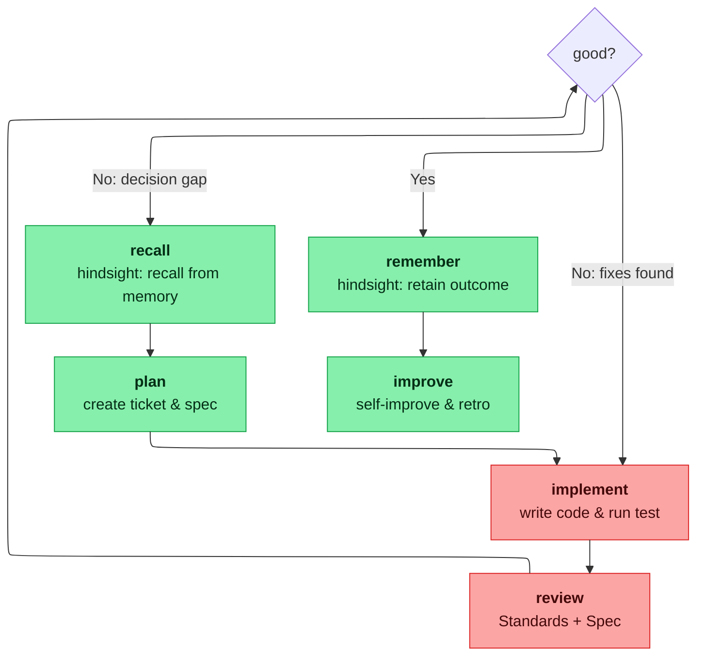

# Feature implementation / bug fixes

> **Load the @following-procedures skill first.** It defines how you run this
> numbered procedure: point-and-call narration, live deviation logging, and a
> fixed post-run report. Always follow the rules in the *Gates* section at
> the bottom.

## When to use

Feature, ticket/spec/plan, or bug fix.

## State machine

```
START (user request: feature / ticket / bug fix)
  → RECALL    hindsight memory: recall decisions/outcomes relevant to the request
      │  server down? → note it, continue without memory
  → PLAN      create a plan in Plan mode
  → GRILL     cover plan gaps
  → PERSIST   session doc + CONTEXT.md + ADRs, then read them
  → RESEARCH  map the code and gather library/API facts
  → IMPLEMENT delegate to implement (tdd; prefer @forkflow after its probe)
  → VERIFY    test/lint/typecheck via implement in verification-only mode
      │  failures? → loop back to IMPLEMENT (RESUME sessions via sessionID)
  → REVIEW    delegate to review (Standards + Spec; fork from the implement report when safe)
      │  fixes found? → loop back to IMPLEMENT, then VERIFY again (RESUME sessions via sessionID)
  → REMEMBER  hindsight memory: retain decisions/deviations/outcomes
      │  server down? → note it, continue
  → FINISH    only on explicit user request
  → DONE
```

Overview — orchestrator vs subagent, with the memory hooks:



## Steps

| # | State | Owner | Action |
|---|---|---|---|
| 1 | RECALL | you | Hindsight MCP `recall` (query = the request, budget `mid`) before planning; load @hindsight-docs for tool details. Server down → note it and continue without memory. |
| 2 | PLAN | you | Create a plan in Plan mode. |
| 3 | GRILL | you | If the plan has gaps: @grilling or @grill-with-docs. If the plan is too large to hold in one session: @wayfinder. |
| 4 | PERSIST | you | @grill-with-docs leaves a `CONTEXT.md` glossary + `docs/adr/` paper trail; read them before implementation so names match the domain language. Persist the plan with @session. Log plan deviations with @session as they surface. |
| 5 | RESEARCH | `research-discovery` | Delegate a preliminary pass to map the relevant code and gather library/API facts, then read the files it points to. For a deeper external fact a decision waits on, invoke the @deep-research skill, which delegates back to `research-discovery` for a cited findings file. |
| 6 | IMPLEMENT | `implement` / `@forkflow` | Prefer `forkflow`: fork the completed research boundary, switch to `implement`, verify, then send the first prompt. Fall back to a fresh `implement` spawn. |
| 7 | VERIFY | `implement` / `@forkflow` | Ask `implement` to run checks in verification-only mode before review. If checks fail, resume IMPLEMENT (step 6). |
| 8 | REVIEW | `review` / `@forkflow` | Fork a read-only review child from the implement report when safe. If it turns up fixes, create or resume an implement session; never switch an already-running child to another agent. |
| 9 | REMEMBER | you | After review passes: hindsight MCP `retain` — decisions, deviations, outcomes. Server down → note it and continue. |
| 10 | FINISH | `finish` | Commit only when the user explicitly asks. Delegate to `finish` to propose grouped commit messages, restate them to the user for approval, then run the `git add` + `git commit` yourself. |

## Dependency graph

- step1
- step2 -> step1
- step3 -> step2
- step4 -> step3
- step5 -> step4
- step6 -> step5
- step7 -> step6
- step8 -> step7
- step9 -> step8
- step10 -> step9

**Parallel lanes.** When the work decomposes into independent units touching
different files, fan out per `reference/parallel-lanes.md` instead of
serialising the chain. The steps inside a lane stay a chain; the lanes run
concurrently, and a file two lanes need becomes a chain of its own.

When @forkflow is available, the handoff is `research report →
fork → switch implement → first prompt`. The implement session owns verification;
review forks from its report as a separate read-only child.
Forks share the working directory: parallel writers need separate
worktrees. Broader forkflow + setup-dev-docs + task-context
orchestration waits until exercised on a real ticket.

## Gates

- RECALL runs on every loop entry; a hindsight MCP failure is a skip, not a failure.
- GRILL only runs on plan gaps.
- A step skipped because its gate did not fire is not failed, and later steps still run.
- REMEMBER fires once review passes; IMPROVE stays inside FINISH and keeps its explicit-user-request gate.
- FINISH only runs on explicit user request.
- VERIFY always runs before REVIEW; no implementation reaches review with failing tests.
- Loop REVIEW → IMPLEMENT → VERIFY while review turns up fixes; always resume the same sessions.
- A lane starts only when its scope is disjoint from every other lane's scope.

## Parallel multi-repo batches

When one piece of work spans multiple repositories (e.g. a dependee/dependency pair),
run the batch in parallel. This is a lane batch with one lane per repo;
`reference/parallel-lanes.md` holds the general procedure.

- One independent `implement` agent per repo. Never share a session across repos.
- Downstream compile gate: after any change that affects a dependee's view
  (visibility, public signatures, message shapes), run `cargo check` (or the
  equivalent) in the dependee before declaring the batch green.
- Bounded retry: when a sibling repo's tree is dirty, retry the dependee check in a
  tight window (a few tries) rather than serializing the whole batch.
- Never-touch-sibling: each `implement` agent edits only its own repo; cross-repo
  coupling is resolved by the downstream gate, not by editing both.
- Keep review gates per repo (delegate `review` for each repo independently).
