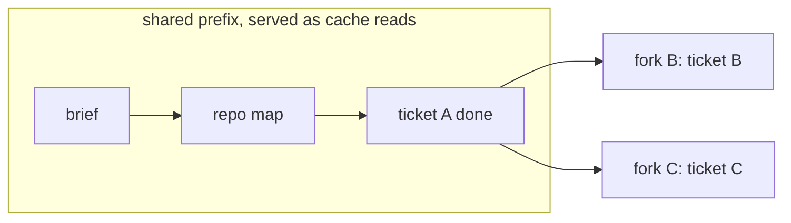
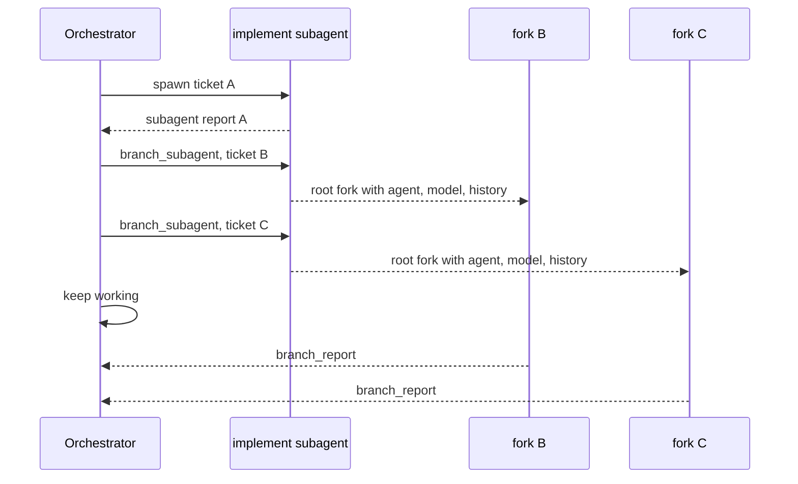
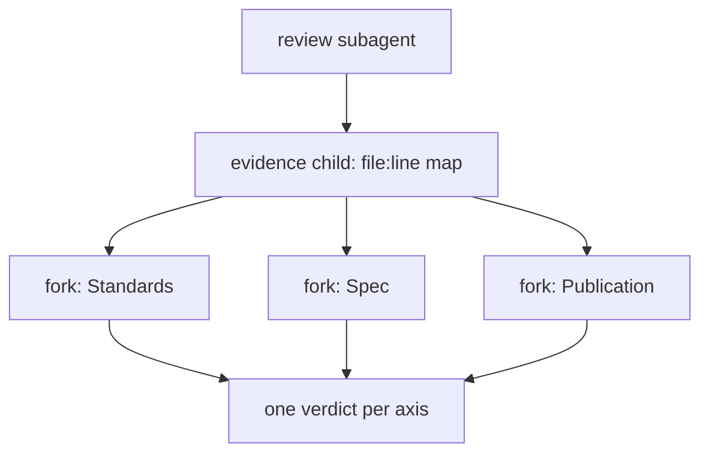

# Subagent forks

A lane that needs a specialist role and warm context forks the finished
subagent, not the orchestrator, so the clone starts with the specialist's
agent, model, and history. `branch_subagent` is the only flow.

`branch_ask` covers the other axis: a lane that needs this session's own
history. It forks the caller and is primary-only. See
[parallel-lanes.md](parallel-lanes.md).

## Scenario

An `implement` subagent finished ticket A. Its session holds the repo map, the
conventions, the test commands, and the measurements from A. Tickets B and C
touch different files and can run at once.

A fresh child re-learns the repo for each ticket. The orchestrator's own fork
inherits the orchestrator's agent, not the implementer's role. Forking the
finished implementer gives both: its role and its context.

## The shared prefix

The fork copies projected history up to its latest message. The provider sees
the same prefix for every fork, so only the divergent suffix is billed as new
input. Switching the agent rewrites the system prompt at position 0 and drops
the shared prefix from the cache. Fork the subagent that already has the role
before considering a switch.

## The flow

One `branch_subagent` call per lane. `sessionID` names the finished subagent,
`prompt` names the ticket and the report contract.

The target rules:

- **Descendant.** A child, grandchild, or deeper. A session outside the
  caller's tree is refused.
- **A subagent.** It has a `parentID`. A root session, including an earlier
  fork, is not a target.
- **Finished.** Its turn has an `outcome`. A running target is refused so the
  fork copies a whole turn.
- **Not the caller.** Forking yourself is `branch_ask`.

The fork is a root session: its `parentID` is null, so OpenCode's automatic
`<subagent>` report, parent wake, session-tree entry, and depth accounting do
not apply. The caller collects through `branch_report` instead, which arrives
tagged `<branch sessionID=… parent=…>` like any other fork report.

`silent: true` skips the notice and the report. `background: true` keeps the
UI view on the caller. `agent` switches the fork's role before it starts, with
the cache cost above.

## Review axes

Scenario: a `review` child gathers evidence through one `explore` child, then
runs the Standards, Spec, and Publication axes. Fresh axis children re-read the
repo. Fork the evidence child once per axis so all three start from the same
file:line map.

Each `branch_subagent` call names the evidence child and one axis. The review
session holds the verdicts: it aggregates its children's reports, never merges
or reranks across axes, and never edits the target.
